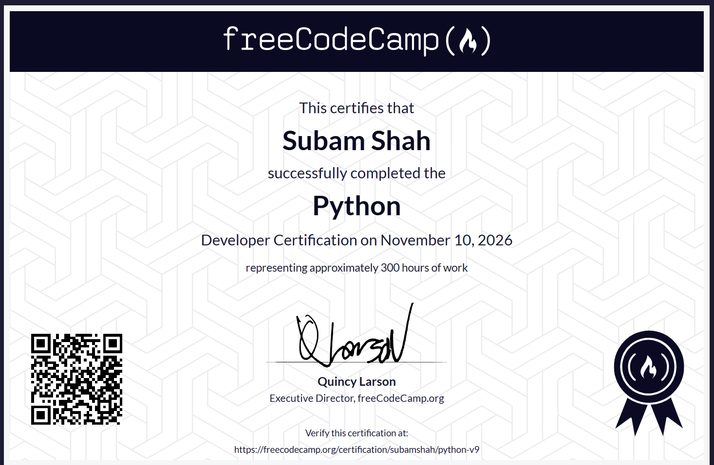

# Certifications
# 🏆 My Certifications

Welcome to my certifications repository! This repository showcases my learning journey, professional certifications, and technical skills acquired through online courses and practical learning.

## 🐍 Python Programming

**Certification:** Scientific Computing with Python  
**Platform:** freeCodeCamp  
**Status:** Completed ✅

### 📜 Certificate

### 💡 Skills & Concepts Learned

- Python Fundamentals
- Data Types and Variables
- Functions and Modules
- Object-Oriented Programming
- Data Structures
- Algorithms
- Recursion
- Searching and Sorting
- Problem Solving

## 🎯 Purpose of This Repository

The purpose of this repository is to:

- Document my continuous learning journey.
- Showcase my technical certifications.
- Track my progress in programming and technology.
- Maintain a collection of achievements.

## Next?

I will continue expanding this repository as I complete more courses, certifications, and technical learning programs.

---

**Learning. Building. Growing.**

